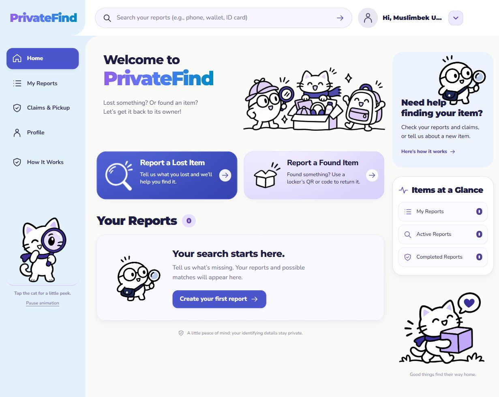
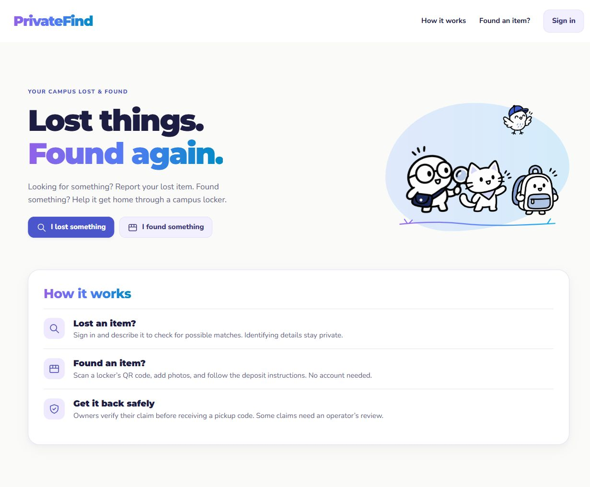
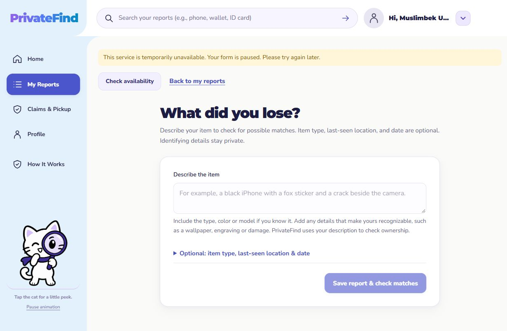
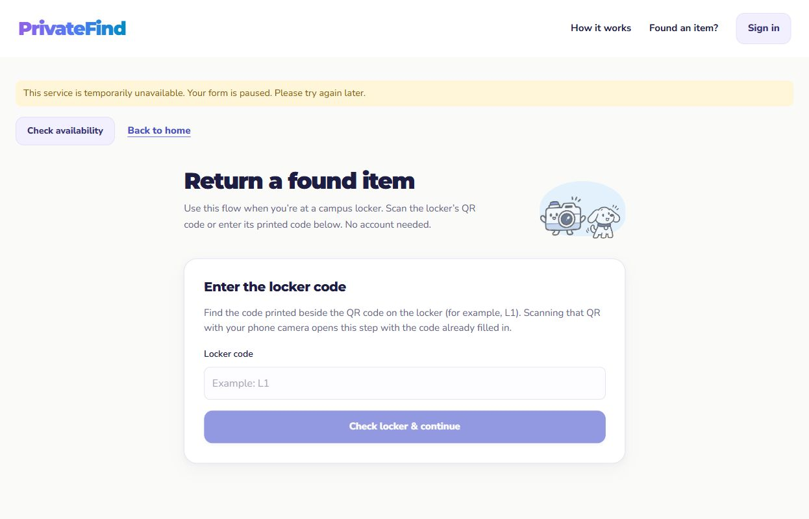
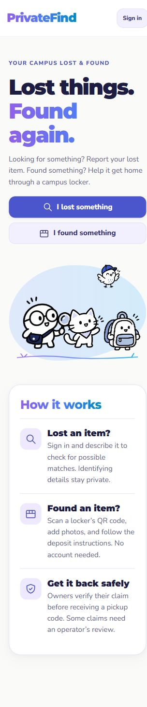
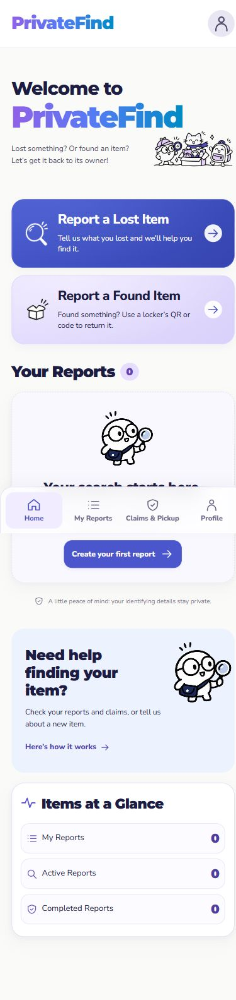
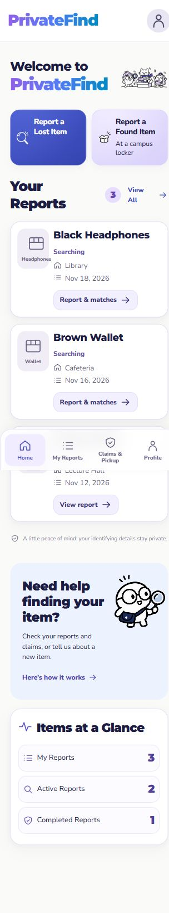
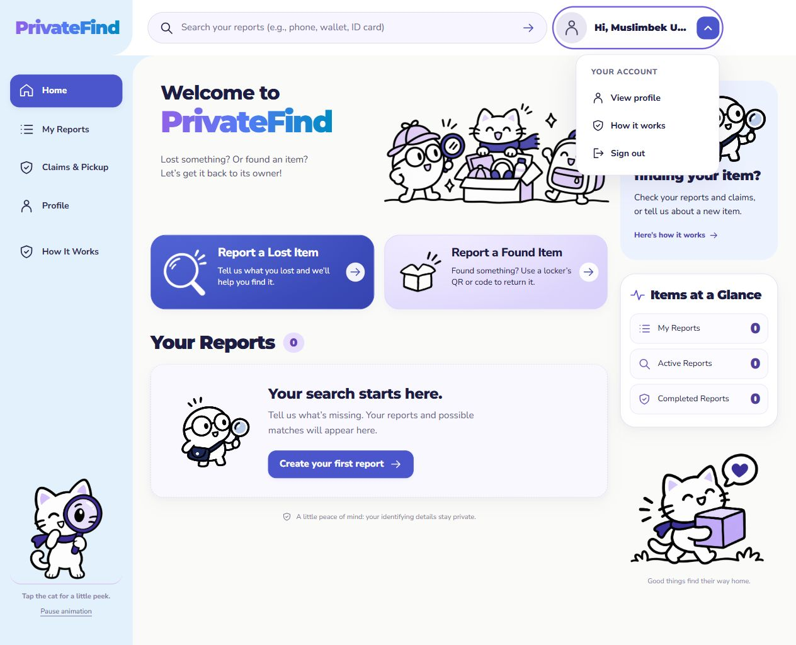

# PrivateFind gradient audit — 2026-11-25

Branch: `feature/iot-ui-redesign`. Baseline: `75304ec`. User instruction: “audit it, if it is fine commit it.”

**Verdict: passed for the pending gradient typography refinement.** No blocking issue was found in the changed surfaces. Approved for a local commit; no push, merge or deployment. The previously undone secondary-page experiment remains absent.

## Scope and method

Audited branding, Owner Home and public landing typography, desktop/mobile layout, primary navigation actions, keyboard account disclosure and retained mascot controls. Used the running app on port 8002 and the existing read-only sample fixture on 8003 for populated reports. All eight screenshots below were captured and the saved files opened during this audit run. Historical implementation captures are separate and were not used as fresh audit evidence.

## Steps and findings

1. **Owner Home desktop — healthy.** At 1246 × 800 CSS px, the light-blue sidebar and warm-white canvas remain coherent. Branding and welcome text have static purple/blue/cyan gradients; ordinary UI text and status colors remain solid. Both report action titles fit on one line. No horizontal overflow or secondary-page atmosphere markup. Computed gradient sizes: 29px/900 and 48px/900. No blocking readability or spacing finding.

   

2. **Public landing desktop — healthy.** Main Lost/Found choices remain easy to distinguish. Selected hero and guide phrases use the gradient; the composition wash and ground stroke are restrained. Mascots retain clear edges and existing geometry. No horizontal overflow. Gradient type: 29px/900 wordmark, 62.32px/1000 computed hero, 27.2px/800 guide heading. The font stylesheet supplies Montserrat through weight 900; the browser resolves the hero's inherited 1000 request to the available heavy face.

   

3. **Lost-item action — navigation healthy; submission blocked by existing service state.** Activating “I lost something” with Enter reaches `/owner/report/new`. The existing service-unavailable banner, availability control, return link and disabled form are understandable. No form was submitted. Successful report creation cannot be assessed while this service is unavailable; the guard is preserved and is outside this presentation change.

   

4. **Found-item action — navigation healthy; submission blocked by existing service state.** Clicking “I found something” reaches `/found/new`. The locker prerequisite and existing unavailable-service guard remain visible. The branding gradient does not spread into form labels or warning text. No locker action or submission was attempted. Successful deposit/hardware behavior remains unverified.

   

5. **Public mobile at 320 × 844 — healthy.** Header, Sign in and stacked primary actions remain readable with no horizontal overflow. The hero phrase wraps naturally; decorative art stays within the content column. Gradient type remains large/bold: 25px/900, 44px/1000 computed and 25px/800. Wrapping produces a less complete color sweep on each individual line, an acceptable responsive presentation difference rather than a clipped-text failure.

   

6. **Owner Home empty mobile at 390 × 844 — healthy.** The welcome wordmark, action labels, report empty state and navigation remain understandable. No horizontal overflow. Gradient sizes: 28px/900 branding and 48px/900 welcome. The bottom navigation appears at its viewport position within the full-page screenshot; this is a fixed-element capture artifact, not a permanent overlay across that document section while scrolling.

   

7. **Populated Owner Home at 320 × 844 — healthy with expected narrow wrapping.** Three sample reports remain data-first and have distinct report actions. Branding stays 28px/900 and the compact welcome wordmark 31px/900. No horizontal overflow. “Your Reports,” “View All” and the Claims & Pickup navigation label wrap at this width; they remain legible and actionable. Evidence uses synthetic read-only fixture data, not a successful backend/API exercise.

   

8. **Account and mascot controls — healthy.** Enter opens the account menu with a visible focus ring; Escape closes it. Menu choices remain solid-color text. Pause changes to Resume and disables the cat play control; Resume restores the control and prompt. Keyboard activation of the cat remains accepted; the animation regression tests provide the state-level verification. Temporary viewport overrides were reset. No browser error entries were reported in the checked session.

   

## Contrast and regression evidence

- 35 Node checks passed: 11 reporting readiness, seven companion motion, six UX fixes, seven cat peek/blink, four gradient/solid contrast checks.
- 34 template route/state render checks passed, including duplicate-ID checks.
- `git diff --check` passed.
- Display gradients sampled across both segments have minimum contrast 3.62:1 on warm white, 3.29:1 on light blue and 3.79:1 on white. The checked display sizes and bold weights qualify for the 3:1 large-text threshold. Solid fallbacks are 6.60:1, 6.00:1 and 6.90:1 respectively. Body/secondary/error/warning/success token checks meet 4.5:1 on warm white. See the implementation review for the sampling method and [W3C contrast guidance](https://www.w3.org/WAI/WCAG22/Understanding/contrast-minimum.html).
- Source inspection confirms solid fallbacks for unsupported text clipping, print, forced colors and higher contrast. Those operating-system modes were not visually emulated.
- Reviewed pending production changes are limited to CSS and presentation templates. Backend, preview/proxy, application JavaScript, API requests, authentication, reporting logic, sandbox safeguards, hardware integration and mascot bitmaps have no pending diff.
- No new framework or dependency was introduced; fonts use the existing Google Fonts integration.

## Limits and follow-up

This is a scoped audit of the remaining gradient refinement, not full-app accessibility certification or end-to-end hardware validation. Live successful submissions and pickup workflows require restored service availability. No P0/P1/P2 change is required before the authorized local commit. Optional future refinement: reduce narrow 320px report-section heading wrapping if that width becomes a priority.
