# Illustrated secondary backgrounds — 2026-11-25

Branch: `feature/iot-ui-redesign`. Latest existing commit: `8602894`. All current work remains uncommitted; no push, merge or deployment.

final result: passed

## Scope and source

Source: `C:/Users/MSI/Downloads/ui photos/PrivateFind Campus Lost & Found UI Collage.png` (1536 × 1024). Used its Claims & Pickup, Profile and My Reports quadrants as the background/composition reference. This is a scoped addition of background features, not a wholesale replacement of navigation, typography, actions or public landing content.

Preserved all earlier uncommitted frontend refinements and the audit report. The previous audit's medium-priority usability/accessibility findings remain open; passing this background comparison does not resolve them.

## Implemented

- Shared transparent illustrated backdrop: flowing light-blue/lavender edge layers, dotted top corner, faint looping routes and small mint ground details. Real UI content remains HTML above the decoration.
- A single reusable `atmosphere()` macro supplies the image to the three secondary pages. Background opacity is strongest for empty/static pages, reduced on phones, and lower for populated lists. Decorations are static, `aria-hidden` and ignore pointer input.
- **My Reports:** the empty card now contains the approved map-reading mascot and its supporting search doodle, with a light dashed outline. Populated reports keep the original compact heading scene and solid data cards.
- **Claims & Pickup:** the empty card contains the approved cat/checklist scene and shield doodle. CSS switches between that scene and the compact heading scene using the existing empty/list state. Only one is visible at a time; loading, error and API logic are retained.
- **Profile:** the approved calm cat/desk/lamp composition sits beside the account card on wide desktop layouts. Tablet and mobile return it to a small heading anchor, preserving room for account information and actions.
- Print/forced-color/higher-contrast styles hide decorative imagery and collapse the Profile illustration column. The new PNG uses the existing static asset pipeline; no new framework or dependency.

## Artwork and provenance

Final asset: [privatefind-secondary-atmosphere.png](../../frontend/assets/privatefind-secondary-atmosphere.png), 1536 × 1024 RGBA, 953,980 bytes. The center pixel is genuinely transparent `(0, 0, 0, 0)`; the PNG is used without post-processing or replacing any approved mascot image.

Built-in Image Gen produced the background using the supplied collage as the visual reference. [Generation prompt and method](secondary-background-art-prompt-2026-11-25.md).

Asset brief: one quiet landscape background for a roughly 1000 × 720 CSS px secondary page; soft layered `#E3F1FC` blue and `#EDE7FB` lavender edges, a blue dotted patch, faint winding routes, tiny muted mint foliage at bottom corners, and an empty transparent center for content. No text, logos, UI panels, characters or extra item doodles. Existing page illustrations supply the contextual mascot compositions.

## Visual comparison

Opened the reference and the final Reports desktop screenshot together in one comparison input, then the reference plus Claims and Profile desktop screenshots together in another. Reviewed saved mobile/tablet captures for reflow and density. Source quadrants are approximately 768 × 512 pixels; production screenshots use the app's existing 1246 × 800 CSS viewport. This is a feature/style comparison at different product viewport sizes, not a pixel-equality claim. No screenshot was rescaled or edited. Full-view images were legible enough to inspect the scoped background edges and illustration placement, so a separate focused crop was not necessary.

Required fidelity surfaces:

1. **Fonts/typography:** Montserrat display and Nunito Sans UI/body remain unchanged. Existing gradient wordmarks, solid headings and readable body copy are preserved. The collage's exact font metrics are outside the requested background scope.
2. **Spacing/layout:** layered edge features frame a clear center, matching the reference direction. Empty cards have centered art and guidance. Profile uses a card/art desktop pairing and a compact mobile anchor. Populated lists keep their previous card density; the 390px populated Reports capture has the first report around Y=417px, and the 320px Claims capture around Y=338px. Checked views have no horizontal overflow.
3. **Colors/tokens:** warm-white and light-blue surfaces remain, with lavender/blue decorative layers. Existing indigo controls and semantic status colors are retained intentionally rather than replaced by the collage's brighter blue buttons. Background opacity is .85 on desktop empty/static pages, .65 on phones, and .5 for populated lists.
4. **Image quality:** one real transparent PNG supplies the new detailed backdrop. Approved mascot bitmaps remain unchanged and use their existing atlas/calm-cat assets. The backdrop maps to page edges, while the center stays empty; raster foliage/routes remain decorative. No UI copy or form is embedded in an image.
5. **Copy/content:** product wording, report/claim states, links, account values and the existing locker guidance remain unchanged. Review screenshots use synthetic Student account/report/claim data, avoiding real account details in saved evidence.

Expected differences: existing approved mascot poses instead of the collage's alternate multi-character compositions, existing branding/control colors and live app dimensions, restrained decoration in populated lists, and smaller illustrations on phones. No actionable P0/P1/P2 mismatch remains in this scoped comparison. The first visual comparison passed; no visual repair cycle was needed. The new image's stronger ground/edge details are reserved for non-text regions.

## Checks and limits

- All 35 existing Node regression/contrast checks passed: 11 reporting readiness, seven companion motion, six UX fixes, seven cat peek/blink and four gradient/solid contrast checks.
- All 34 template route/state renders passed, including duplicate-ID checks. `git diff --check` passed.
- Browser verified empty and populated Reports/Claims, Profile, Completed filtering and clearing filters, Claims Refresh, and navigation among the three pages. Background image loaded at its natural 1536px width in the live port-8002 app. No browser errors were reported. Viewport overrides were reset and the live app left open for review.
- The image's heading-copy and central-content regions were sampled against warm white at the strongest .85 opacity: existing muted text retains at least 5.65:1 contrast in those reserved regions. Darker decorative foliage/dot pixels are not text backgrounds; this is a scoped check, not exhaustive accessibility certification.
- Source comparison confirms the complete Claims inline application script is unchanged from HEAD after newline normalization. The entire production preview file is identical to HEAD after removing the single new image's static-asset registration. Backend code, shared application JavaScript, API requests, authentication, reporting safeguards and hardware integration are unchanged.
- The existing read-only visual server on 8003 supplied populated samples and still rejects all writes. No report, claim, pickup, hardware or sign-out action was submitted.
- Print/forced colors/higher contrast were inspected in CSS, not visually emulated. End-to-end backend/hardware behavior and the earlier audit's open usability issues are outside this presentation change.

## Evidence

| File | Image size | CSS viewport/state |
| --- | --- | --- |
| `reports-empty-desktop.jpg` | 1246 × 800 | 1246 × 800, empty |
| `claims-empty-desktop.jpg` | 1231 × 824 | 1246 × 800, empty |
| `profile-desktop.jpg` | 1231 × 824 | 1246 × 800 |
| `reports-populated-desktop.jpg` | 1231 × 900 | 1246 × 800, populated |
| `claims-populated-desktop.jpg` | 1231 × 971 | 1246 × 800, populated |
| `profile-tablet.jpg` | 752 × 924 | 768 × 900 |
| `profile-mobile.jpg` | 375 × 847 | 390 × 844 |
| `reports-populated-mobile.jpg` | 375 × 1112 | 390 × 844, populated |
| `reports-empty-mobile.jpg` | 320 × 844 | 320 × 844, empty |
| `claims-empty-mobile.jpg` | 320 × 844 | 320 × 844, empty |
| `claims-populated-mobile.jpg` | 304 × 1415 | 320 × 844, populated |

Capture density is approximately 1. Width differences reflect the browser scrollbar gutter; full-page captures can exceed viewport height and show the fixed mobile navigation at its original viewport position within the page image.

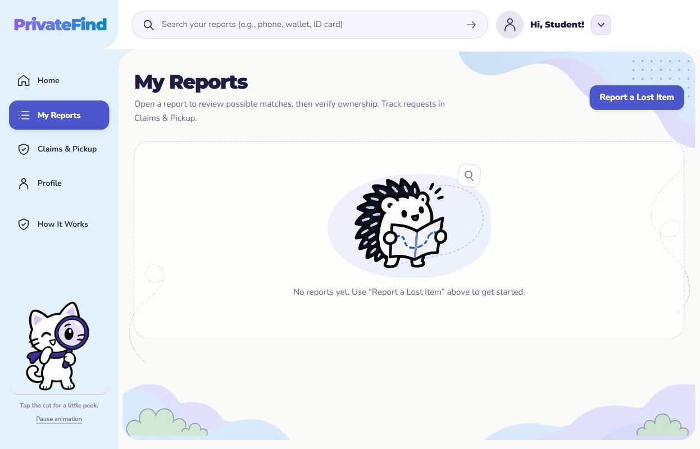

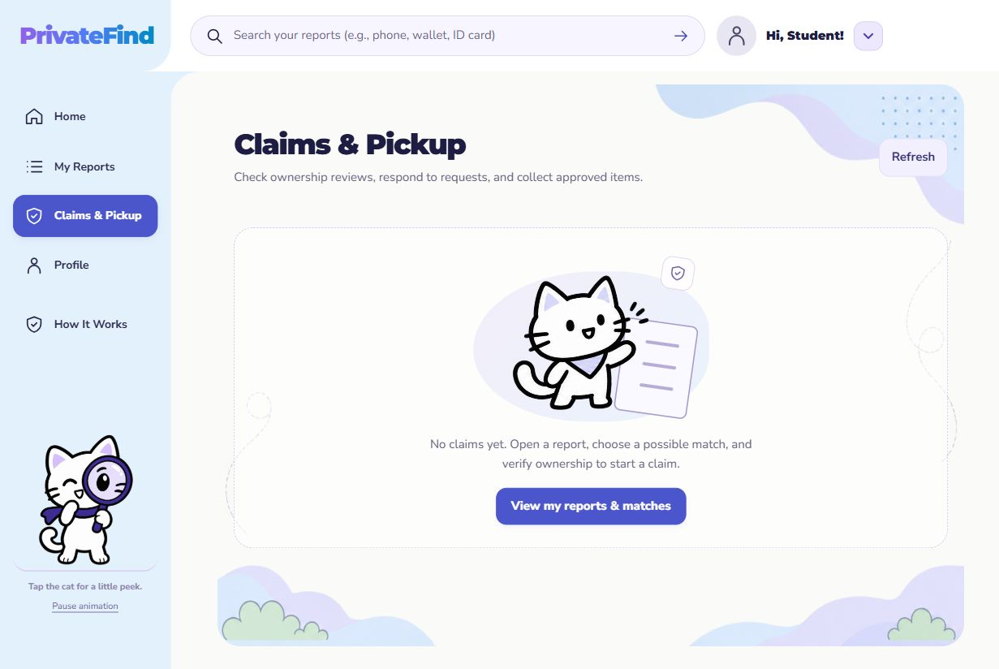

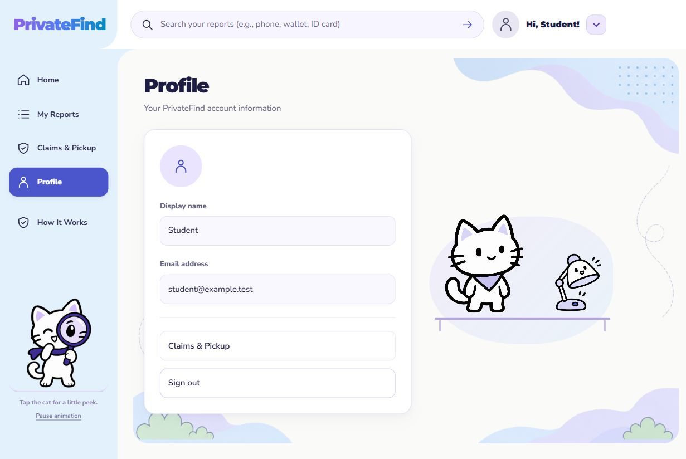

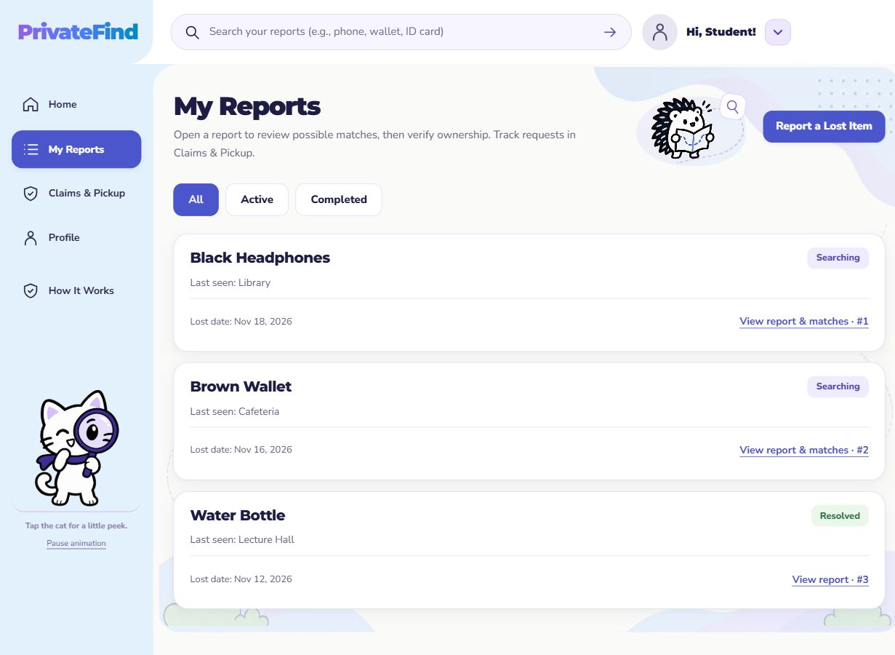

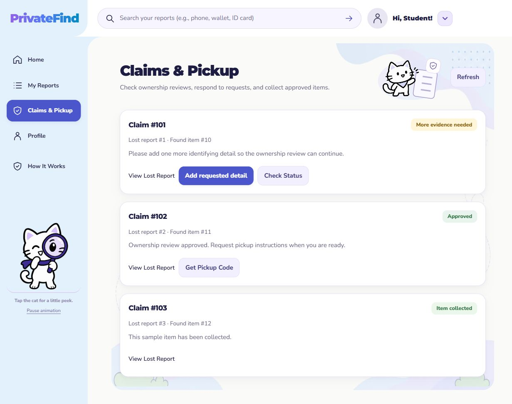

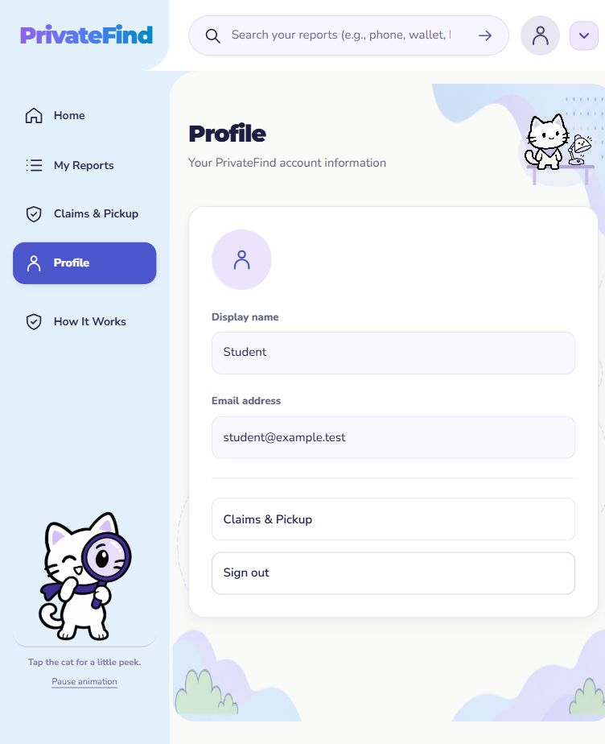

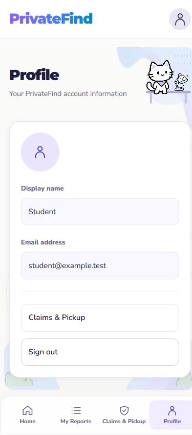

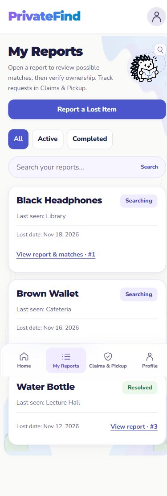

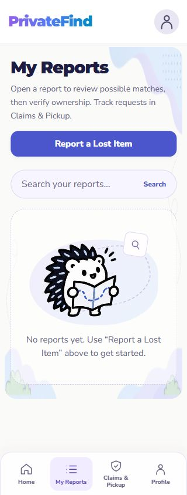

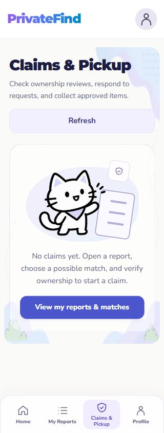

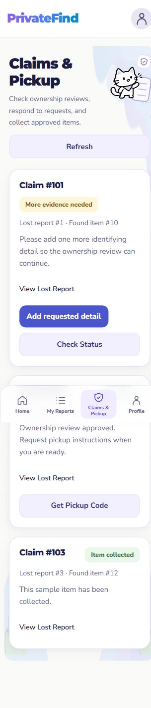
