# Secondary-page audit and repairs — 2026-11-25

Branch: `feature/iot-ui-redesign`. Existing commit remains `8602894`; no commit, push, merge or deployment was performed.

The user clarified that pages 2–5 means **My Reports, Claims & Pickup, Profile and How It Works**. Owner Home's design was to stay unchanged.

**Result:** the reproduced layout/navigation issues are repaired and verified. The earlier data-dependent claim item-name enhancement remains a separate follow-up. This report does not claim a full-app accessibility certification.

## Scope and method

Used the in-app browser, captured fresh evidence in this audit run, opened each saved screenshot and compared before/after pairs together. Read-only sample server on port 8003 supplied synthetic account/report/claim data; the live app on 8002 verified the final owner help route. No report, claim, pickup, hardware or sign-out operation was submitted. Temporary viewport overrides were reset.

CSS viewports: Reports/Claims before/after at 390 × 844; Profile before/after at 900 × 800; guide before/after at 1246 × 800. Additional 320 × 844 captures verify populated Reports, Profile and owner help. Capture density is approximately 1; full-page image dimensions can exceed viewport height and exclude a scrollbar gutter. The fixed mobile navigation appears at its viewport position in a full-page image; that alone is not treated as content obstruction.

## Findings and fixes

### 1. My Reports — repaired, controls healthy

**Before:** the 1536 × 1024 background was rendered about 374 × 577px on the empty phone page, changing its native 1.5 aspect ratio to about .65. It produced elongated waves and foliage. The empty page also offered a search field with nothing to search. Report action accessible names used generic ID wording instead of the visible “View report & matches” wording and item title. The populated introduction consumed unnecessary phone space.

**Fixes:** reuse the same image as separately clipped top/bottom edge layers, with `width: 100%` and intrinsic height. This preserves proportions and leaves long-list centers clear. Hide only the search form for an actually empty report collection; populated search/zero-result recovery still work. Accessible names now include the visible action wording, item title and report number. Shorten the populated introduction while preserving the fuller empty-state guidance.

**Verification:** both background layers measure approximately 1.5 aspect ratio after repair. No overflow at 390px or 320px. At 320px the first populated report begins around Y=417px. Completed filtering and a “wallet” search correctly show a zero-result explanation; Clear search & filters restores all three reports. The accessibility tree announces “View report & matches — Black Headphones, report 1.” One visible contextual scene is retained.

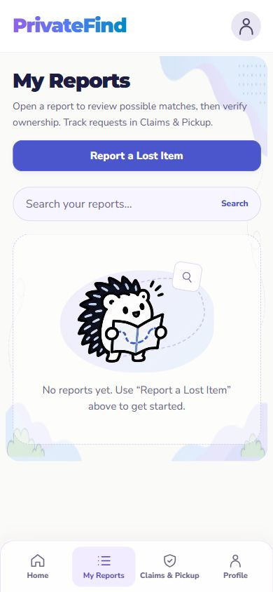

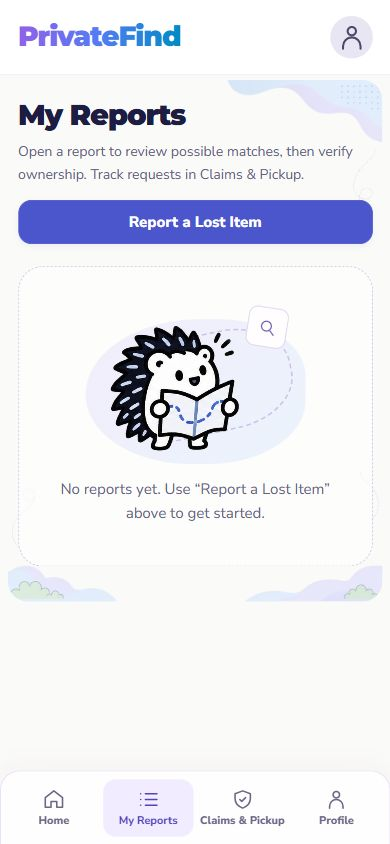

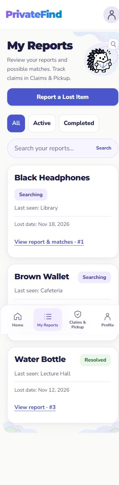

### 2. Claims & Pickup — background and keyboard focus repaired

**Before:** a tall populated phone page stretched the same background to about 374 × 1017px. The existing Refresh handler disabled the focused button and re-enabled it without recovering keyboard focus.

**Fixes:** shared proportional edge layers solve the background distortion. Refresh now records whether it was focused before loading and restores focus with `preventScroll` only if the active element is still the page body. It does not steal focus if the user has moved to another control. API calls, response parsing, status rendering, error handling and pickup actions remain unchanged.

**Verification:** background layers measure approximately 1.5 aspect ratio on the tall page. Keyboard Enter refreshes the sample list and ends with `document.activeElement.id === 'refresh-claims'`; its focus ring is visible in the after capture. Narrow layouts keep actions inside cards. Empty claims retain one visible scene and the existing route to reports/matches.

**Limit:** claims still use report/item IDs when item names are unavailable. The current claims view is not supplied related report titles. No backend/schema change or additional API read was introduced to enrich them, so the earlier item-identification enhancement is still open. Successful ownership verification and hardware pickup were not exercised.

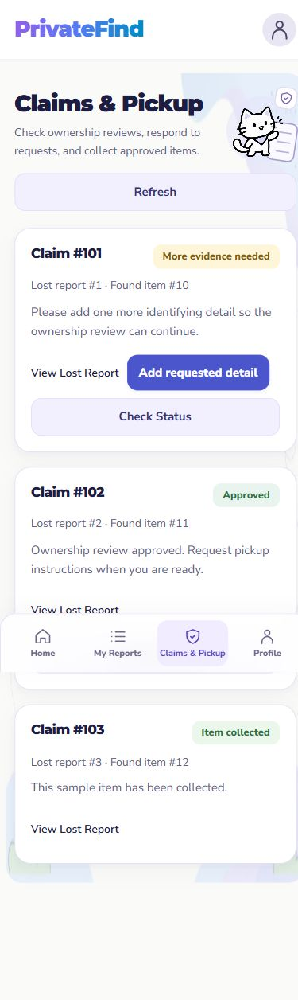

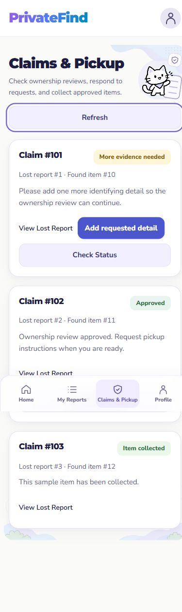

### 3. Profile — layout and read-only presentation repaired

**Before:** at 900px, the heading reserved both 112px right padding for an anchored mascot and an unused 126px grid track. The copy received only 384px of a 642px heading region. Display name and email used input-like boxes despite being non-editable plain values.

**Fixes:** collapse the heading to one content track at the affected breakpoints, keeping the intentional mascot reservation. Use a semantic definition list for account labels/values and plain text styling, with no editable-field affordance. Account values, Claims & Pickup navigation and Sign out behavior remain unchanged.

**Verification:** at the same 900px viewport, the heading uses one 530px content track plus the intentional 112px mascot reservation. The accessibility tree exposes a definition list. Both labels and values remain readable at 320px, with no horizontal overflow. Account actions remain accessible; Sign out was not activated.

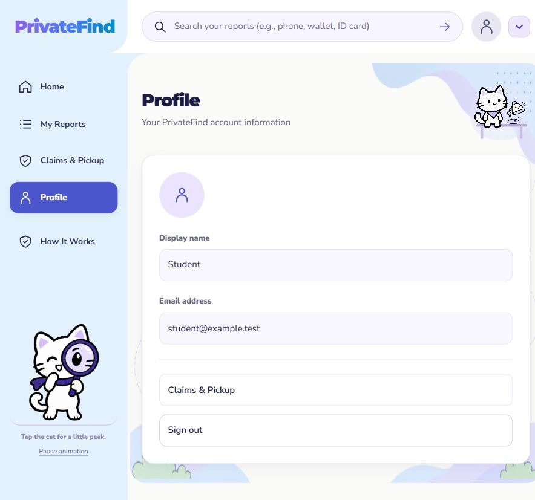

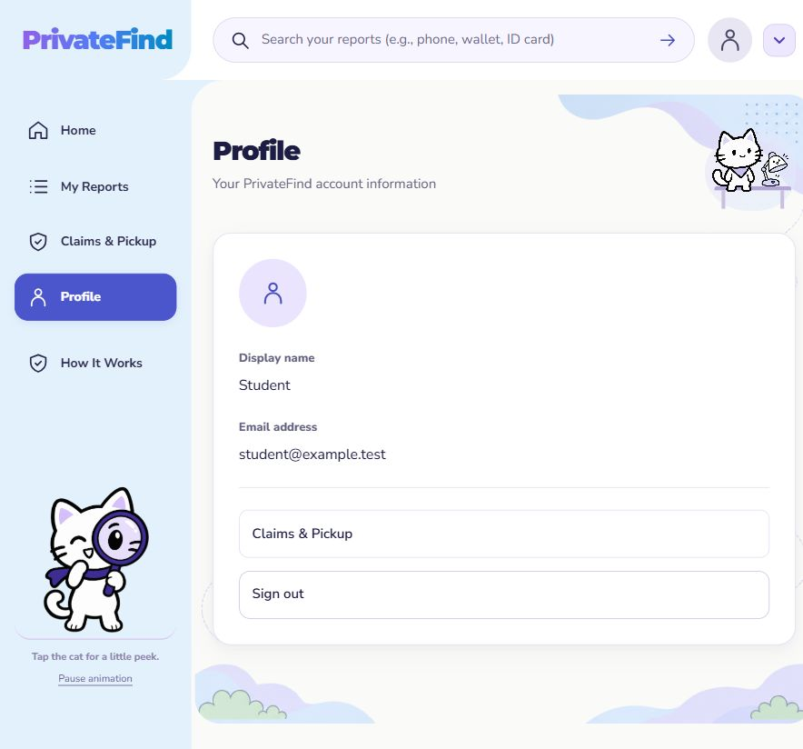

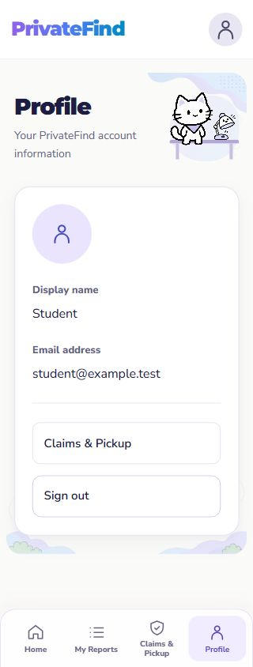

### 4. How It Works — owner context repaired

**Before:** selecting How It Works from the owner sidebar went to `/#public-guide-heading`. The public landing page showed Sign in and removed owner navigation, making a signed-in owner appear to have left the workspace. The guide was also below the public hero rather than presented as an owner help page.

**Fixes:** add `/owner/how-it-works` as a frontend-rendered owner guide using the existing base template, owner authentication guard, visual system and assets. Present reporting, ownership checks and pickup as three steps, plus the existing found-item flow. All actions point to existing destinations. Owner sidebar, header Help, account-menu help and dashboard help now use this owner guide. Public guest help remains on its existing public anchor.

**Verification:** selecting the owner sidebar link loads the new owner route with `aria-current="page"` on How It Works. The owner sidebar/account menu stay visible on desktop and mobile navigation stays visible at 320px. The mobile account-menu help link also reaches the owner guide. Guide navigation to Reports and Claims works. The checked action heights are at least 44px, with no horizontal overflow. The new route also renders in the live app on 8002.

**Owner Home preservation:** its dashboard appearance, illustration assets, action cards and data logic are unchanged. The sole change inside its template is the help-link URL, so that existing help affordance uses the repaired owner flow.

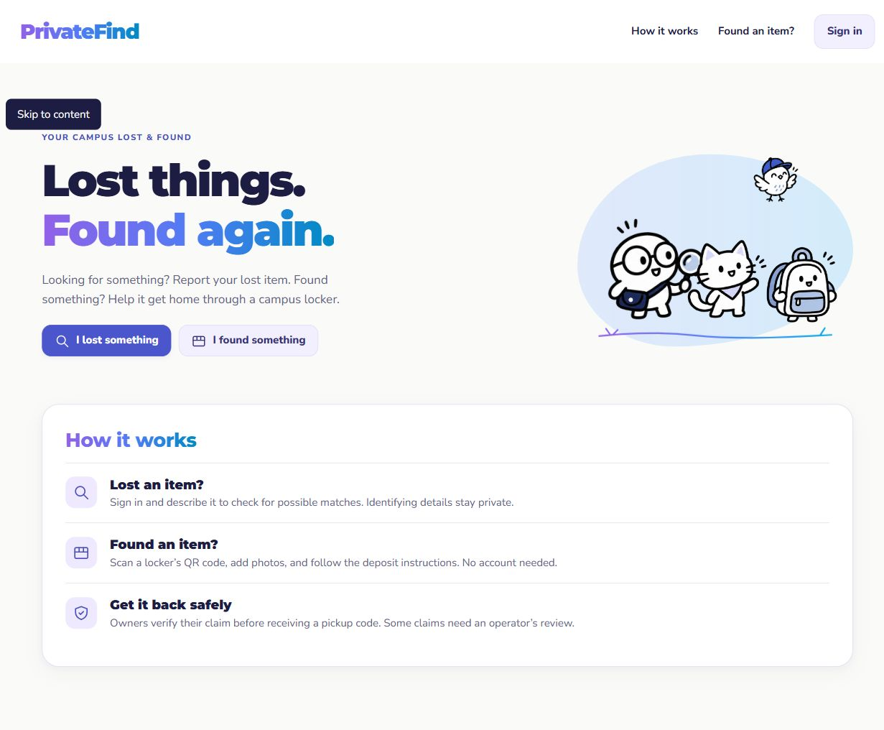

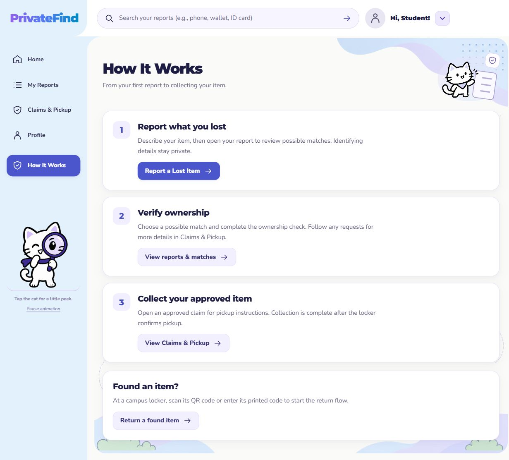

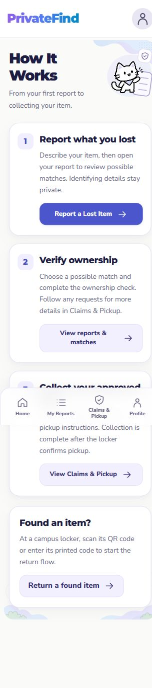

## Regression and preservation checks

- 40 checks passed: 11 reporting-readiness, seven companion-motion, six UX-fix, seven cat peek/blink, four gradient/solid contrast checks and five new secondary-page behavior checks.
- New tests execute the actual Claims inline script with deferred read-only responses. They verify no focus theft on initial loading, focus restoration on successful/failed Refresh, preservation of focus when the user moves elsewhere, and unchanged `/api/claims` request behavior. The owner guide render test checks owner navigation, current-page state and existing action destinations.
- All 36 route/state combinations render successfully with duplicate-ID checks; the count increases by two because of the new owner guide's populated/empty fixture contexts. `git diff --check` passed.
- Existing fonts, solid semantic colors, gradient branding and approved mascot bitmaps are preserved. Only background placement/scaling changed; no asset was regenerated.
- No backend, API endpoint, shared application JavaScript, reporting safeguard or hardware code changed. The production preview registry contains the prior background asset registration and one new frontend page entry; authentication/proxy logic is unchanged.
- Browser error log was empty. The read-only fixture continues to reject all writes. No external screen reader, physical touch device, print/forced-color rendering or end-to-end hardware flow was tested.

## Follow-up

Recognizable item names on claim cards remain a data-dependent improvement. Resolve that separately using authorized existing data, rather than fabricating names or silently changing API behavior. The current repair pass addresses the reproduced layout, context, empty-state, accessible-name and focus problems.
