# Secondary-page atmosphere — 2026-11-25

Branch: `feature/iot-ui-redesign`. Baseline commit: `8602894`.

Result: implemented and checked; changes remain uncommitted for review. No push, merge or deployment.

## Changes

- `frontend/templates/page_scene.html` provides reusable `atmosphere()` and `page_scene(scene)` macros. The system is opt-in on the three requested pages; Home and public pages are unaffected.
- Soft lavender/light-blue radial shapes and a faint dotted texture sit behind content. Each composition has a small local halo; Reports also has a dashed tracking route. New decorations are static, hidden from assistive technology, and ignore pointer input.
- **My Reports:** the approved map-reading mascot anchors a search/tracking scene, with one magnifier doodle. The same single composition appears in empty and populated states; the old repeated empty-state illustration is removed.
- **Claims & Pickup:** the approved cat stands beside a checklist, with one verification shield doodle. The existing empty-state marker remains for the current loading/empty/error logic. Decorative per-card mascots are hidden to avoid repetition; status text and colors are preserved. Actions wrap with clear spacing, and long status badges can move to a new line on narrow phones.
- **Profile:** the approved calm cat appears on a small desk with the existing friendly desk-lamp mascot as the supporting doodle. Account information and actions remain on one readable card; the earlier separate large companion composition is removed.
- Populated scenes are anchored to the heading instead of inserted between data cards. Compact mobile report filters stay on one row at 320px. Existing gradient branding, Montserrat/Nunito Sans, sidebar animation and artwork are retained.
- No new image assets, framework, dependency, application script, animation loop or API request. CSS reuses the existing transparent mascot atlas, calm-cat image and UI icons.

## Verification

- `python frontend/tests/redesign_preview.py --check`: 34 route/state renders passed with duplicate-ID checks.
- Existing Node suites: 11 reporting-readiness, seven companion-motion, six UX-fix, seven cat peek/blink, four gradient/solid contrast checks; all 35 passed.
- Browser checked desktop 1246 × 800, tablet 768 × 900, and phones at 390 × 844 and 320 × 844. No horizontal overflow in the checked layouts. Each requested page has one main scene and one supporting doodle, excluded from accessible names.
- Populated Reports: first card begins around Y=321px on desktop, Y=377px on tablet and Y=440px at 320px phone width. There is no large hero or decoration between report cards.
- Report Completed filtering, search with no matching results, and Clear search & filters work; reset restores all three sample reports. Claims Refresh preserves the populated sample state. Navigation among the three pages works.
- Final screenshot files were opened and inspected. Full-page mobile captures include the fixed navigation at its viewport position; that does not represent a permanently obscured section when scrolling.
- The running app at `http://127.0.0.1:8002/owner/reports` renders the new composition and existing empty state correctly. Browser error log was empty. Temporary viewport overrides were reset.
- Checked populated reports/claims using the existing read-only fixture on port 8003. Added optional `?populated=1` sample claims in `frontend/tests/redesign_preview.py` only. The fixture still rejects all writes and never connects to the real backend. Synthetic data is used in the saved review screenshots.
- Compared the Claims template's complete inline script to HEAD after newline normalization: identical. `backend`, `frontend/preview.py`, shared application JavaScript, authentication, reporting, safeguard/hardware integration and existing illustration bitmaps have no pending diff.
- `git diff --check` passed. Body text, statuses and warnings keep existing solid colors. Decorative layers are disabled for print/forced colors/higher-contrast preferences; those system modes were inspected in CSS rather than visually emulated.

This is frontend layout verification, not an end-to-end pickup or hardware test. No report, ownership claim, pickup request or sign-out was submitted.

## Review images

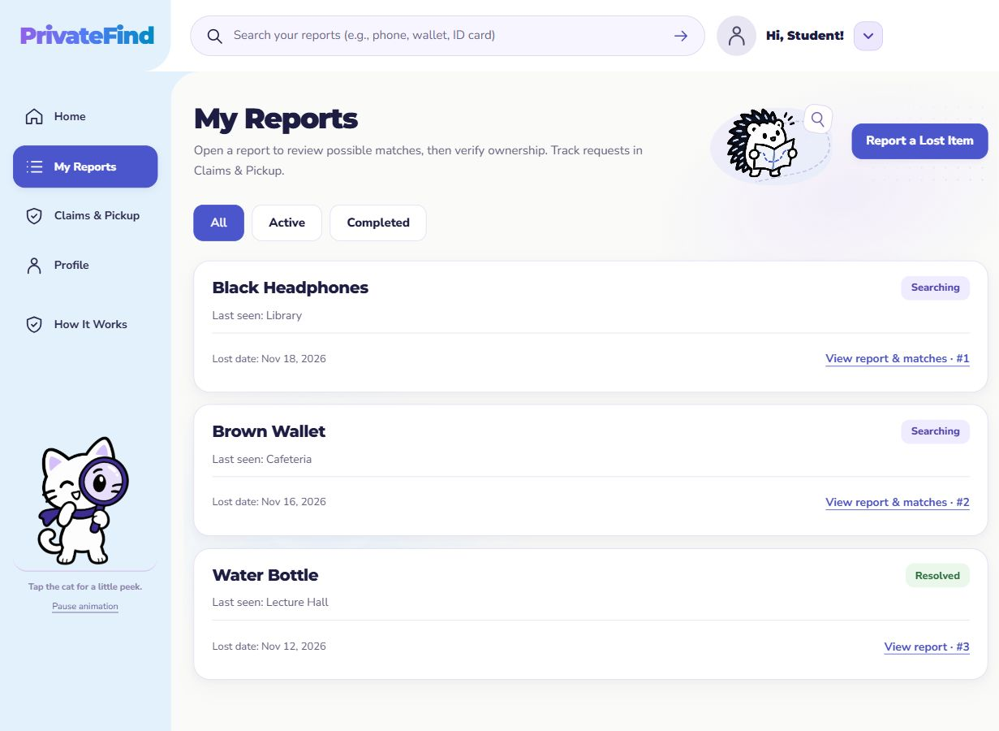

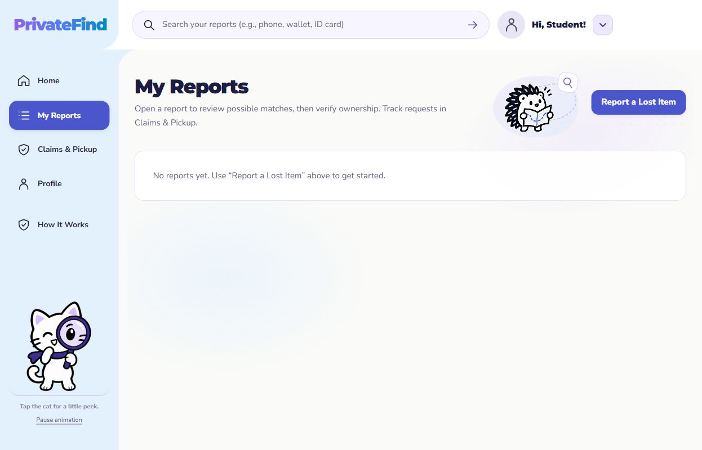

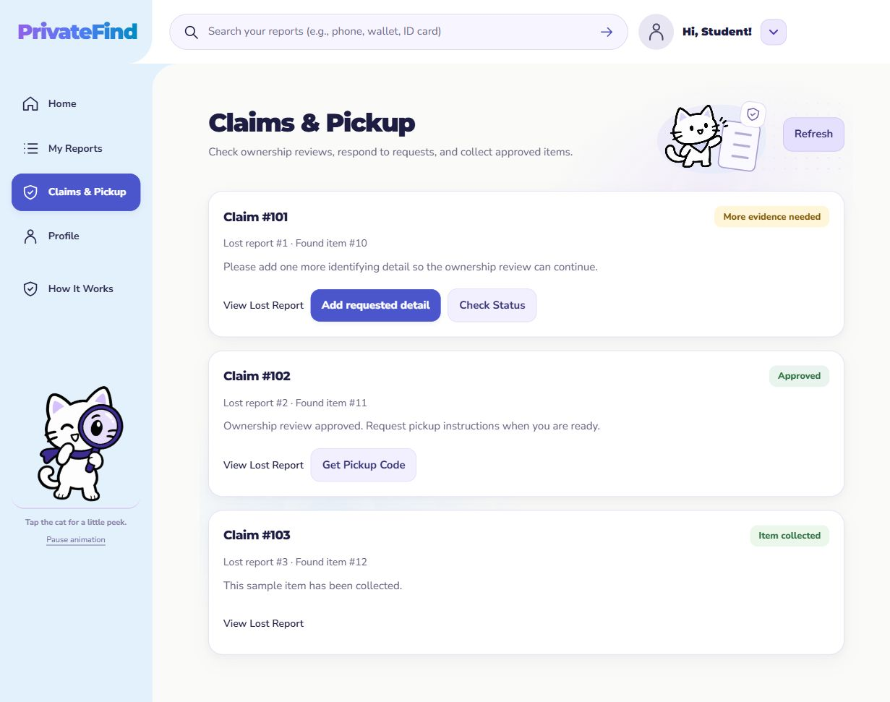

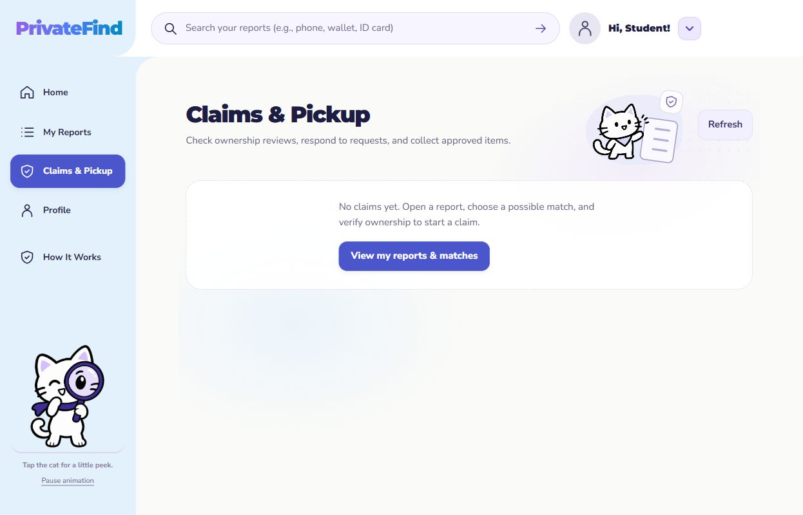

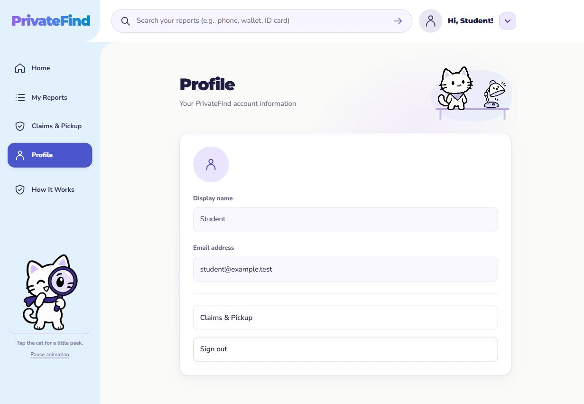

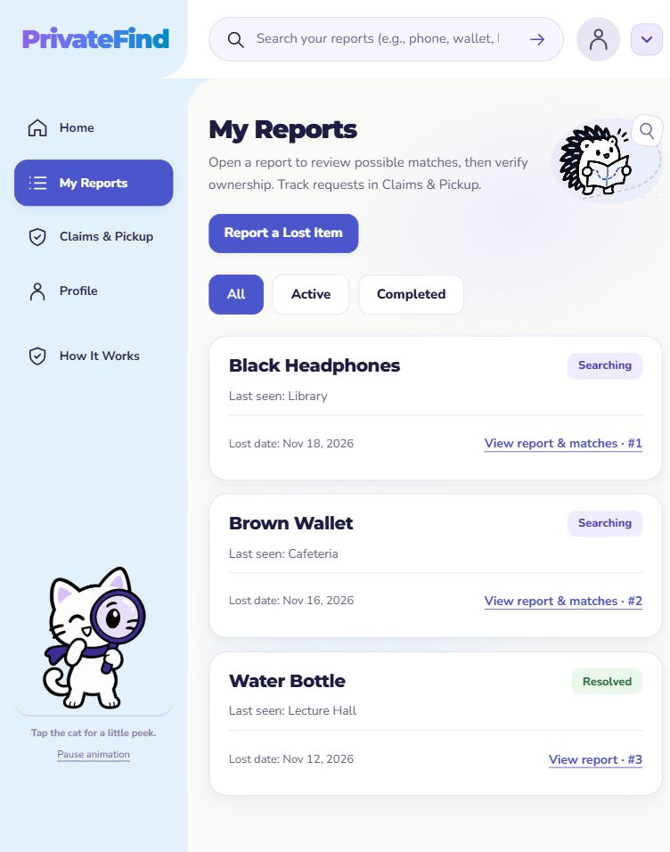

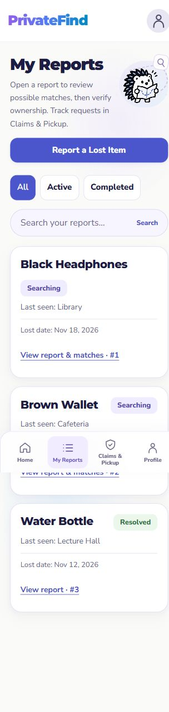

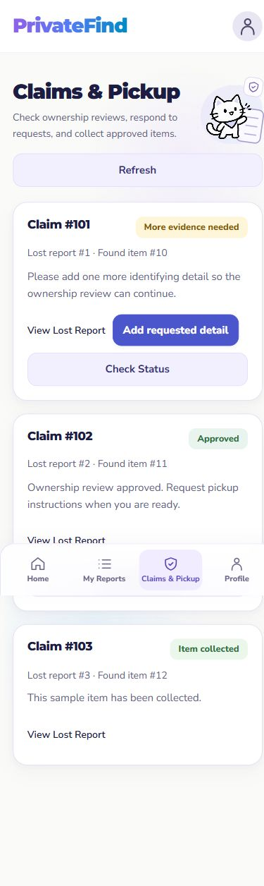

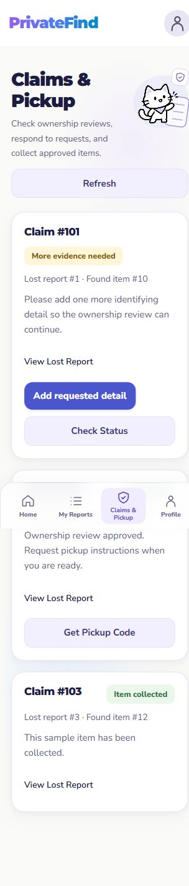

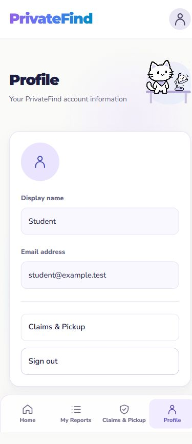

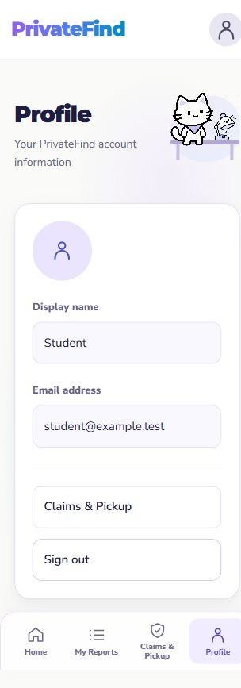
