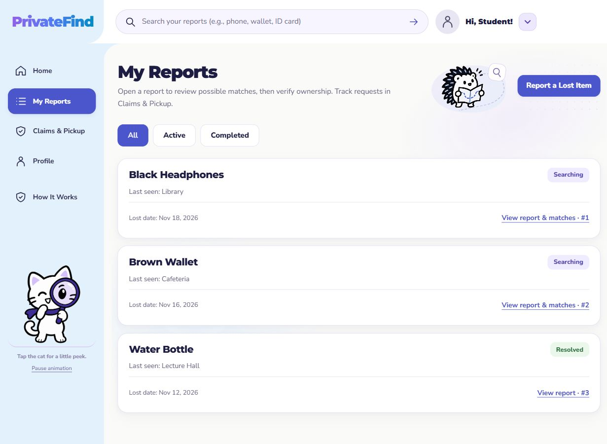
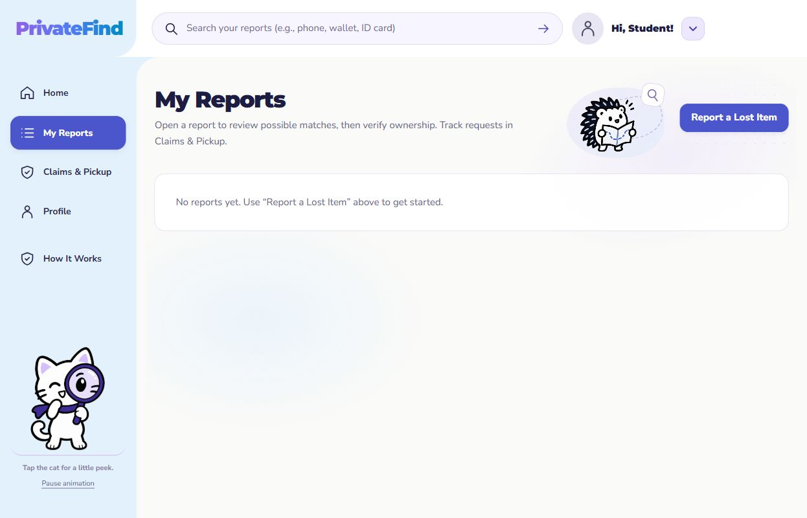
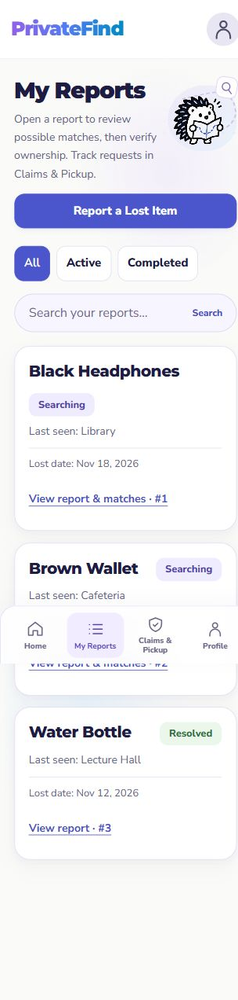
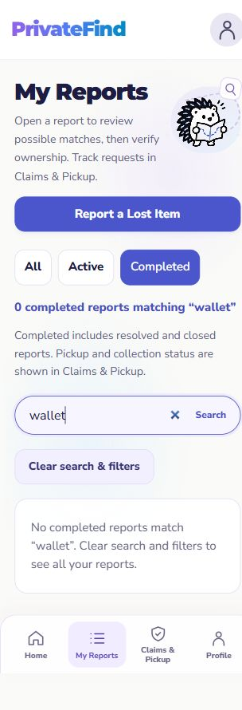
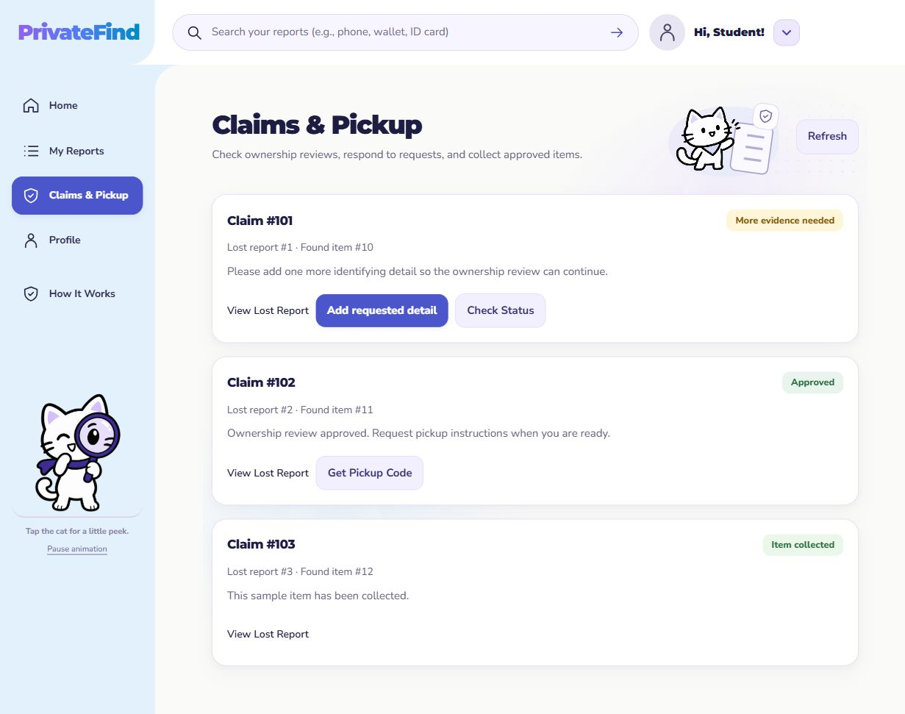
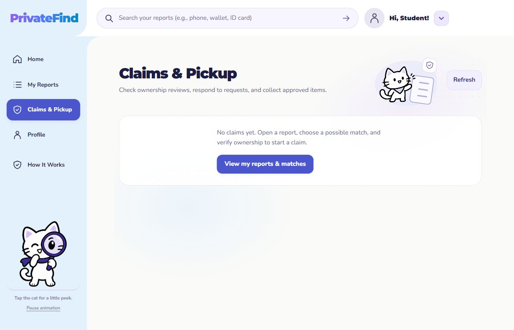
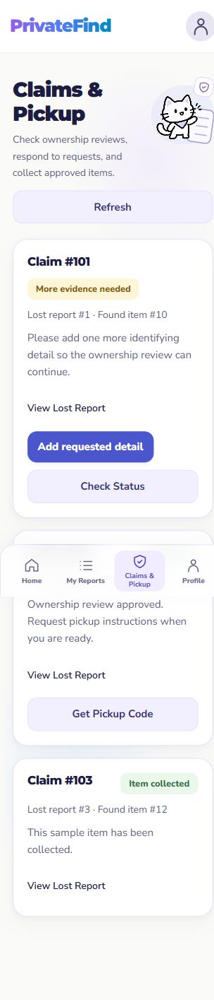
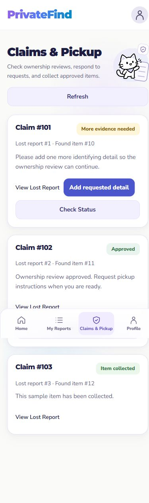
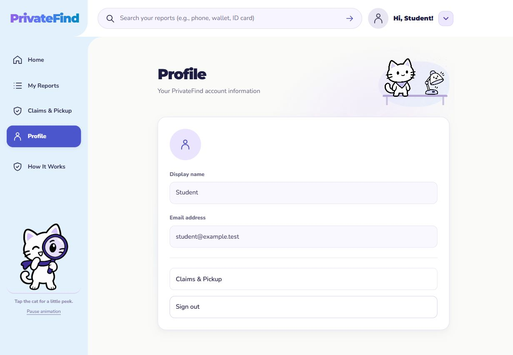
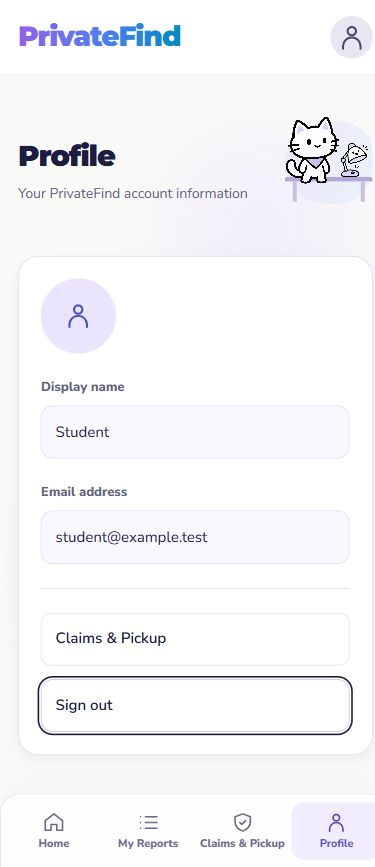

# PrivateFind secondary-page UI/UX audit — 2026-11-25

Branch: `feature/iot-ui-redesign`. Audited the current uncommitted secondary-page refinement against baseline `8602894`.

**Verdict:** the atmospheric treatment is visually sound and does not obstruct controls or data. No P0/P1 issue was found in the checked flow. Three medium-priority usability/accessibility issues and two minor refinements remain. Address the medium-priority items before calling the experience fully polished.

This audit changed documentation only. No application code was changed, committed, pushed, merged or deployed during the audit.

## Scope, goal and method

Combined UX and accessibility review of My Reports, Claims & Pickup and Profile. User goals: find the correct report or claim, understand its state and next action, and read account information. Focus: buttons, understandable wording, visual hierarchy, spacing, mobile reflow, keyboard behavior and decorative interference.

Captured fresh screenshots in this audit run using the in-app browser. Opened and inspected each saved file before accepting it. Desktop: 1246 × 800 CSS px; narrow phone: 320 × 844; Profile/focus reproduction: 390 × 844. Full-page screenshots may exclude the scrollbar gutter and show the fixed bottom navigation at its original viewport position within the document image. That screenshot behavior is not counted as a content-obstruction defect.

Populated/empty states use the existing read-only preview on port 8003 with synthetic data. The normal app on port 8002 was also opened at the end to verify that the new reports composition renders there. All temporary viewport overrides were reset.

## Prioritized findings

### F1 — P2: claims cannot be recognized by item name

**Evidence:** steps 3–4, `03-claims-desktop.jpg` and `04-claims-mobile.jpg`. Cards say “Claim #101,” “Lost report #1” and “Found item #10,” without an item title. The template renderer explicitly constructs the heading from the claim ID only (`frontend/templates/owner_claims.html:259`).

**Impact:** owners with several claims have to remember identifiers or open reports one by one to find their headphones or wallet. The report list already uses recognizable item names, so the transition to Claims loses useful context.

**Recommendation:** show the related item's title prominently, retaining claim/report IDs as secondary metadata. Reuse existing authorized owner report information where available; preserve API contracts and provide an honest ID fallback when a title is unavailable. This behavior predates the atmosphere refinement.

### F2 — P2: Refresh loses keyboard focus

**Evidence:** step 4, `04b-refresh-focus.jpg`, live accessibility state and read-only DOM inspection. Started with keyboard focus on `button#refresh-claims`, activated Enter, waited for Claim #101 to reappear, then observed `document.activeElement.tagName === 'BODY'` with no focused control. A following Tab reached “Skip to content.” The existing handler disables Refresh during the request and re-enables it without restoring focus (`frontend/templates/owner_claims.html:437`).

**Impact:** keyboard users lose their place and visible focus after a routine read action. The list refresh itself succeeds and its loading state is announced.

**Recommendation:** preserve/restore focus to Refresh when the user initiated the refresh and has not moved elsewhere, and announce completion without changing endpoints. Avoid stealing focus if the user navigated away during loading. This is existing behavior, not an effect of the new decorative system.

### F3 — P2: report link names differ from their visible labels

**Evidence:** steps 1–2, screenshots plus accessibility/DOM inspection. Visible text is “View report & matches · #1”; the accessible name is “View report 1 details” (`frontend/templates/owner_reports.html:273`). It also omits the item's recognizable name.

**Impact:** screen-reader users receive different action wording; voice-control matching may be less predictable. A list of links identifies reports by number rather than by the item users are looking for.

**Recommendation:** include the visible action wording and related item title in the accessible name, for example “View report & matches — Black Headphones, report 1.” Preserve the current destination. This mismatch already exists in the baseline.

### F4 — P3: Profile information looks editable

**Evidence:** steps 5–6. Display name and email are rendered in bordered, filled rectangles similar to the app's form inputs. They are plain `div.account-value` elements; their adjacent `label` elements have no `for` association (`frontend/templates/owner_account.html:145`).

**Impact:** some users may tap the values expecting to edit them. Values are still readable in document order; no blocked editing feature is inferred.

**Recommendation:** present a clear read-only details list, using appropriate label/value semantics such as `dl`/`dt`/`dd`, or explicitly state that these are account details for viewing. Do not introduce account editing or new backend work as part of this polish fix. The field structure predates the current refinement.

### F5 — P3: narrow Reports entry can be more compact

**Evidence:** step 2, `02-reports-mobile.jpg`, 320px viewport. The introductory paragraph wraps to five lines beside the 88px mascot column. The first report starts around Y=440px. Filters fit one row and the first card remains usable, so this is a density opportunity rather than a broken layout.

**Impact:** repeat users spend more of the initial phone viewport on explanatory content before reaching their data.

**Recommendation:** shorten the populated-state introduction or reduce its emphasis while retaining the single anchored mascot and all search/filter controls. Keep full guidance available in the empty state. No text clipping or removal of important instructions is recommended.

## Captured steps and health

### 1. My Reports desktop — usable, accessible naming needs refinement

**Strengths:** clear item titles, distinct statuses, one search/tracking composition and one doodle. Decoration has `aria-hidden="true"` and `pointer-events: none`. No horizontal overflow. Checked report action targets are 44px high. Empty-state guidance points to the existing Report a Lost Item action.

**Finding:** F3. **Limit:** accessible names were inspected, but no external screen reader or voice-control session was run.

### 2. My Reports mobile and search recovery — healthy controls, minor density issue

**Strengths:** no overflow at 320px; All/Active/Completed fit on one row and measure approximately 45px high. Search and report actions measure 44px high. Completed selects the resolved item. Searching “wallet” within Completed clearly explains the zero-result state. Keyboard activation of Clear search & filters restores all three reports.

**Findings:** F3 and F5. **Limit:** the read-only fixture verifies frontend filtering/navigation, not successful report submission.

### 3. Claims & Pickup desktop — readable, item identification needs work

**Strengths:** the cat/checklist scene stays at the heading; cards remain solid and data-first. More evidence needed, Approved and Item collected have distinct status text. Add requested detail and Get Pickup Code remain understandable actions. The empty state gives a concrete route back to reports and matches. No horizontal overflow.

**Finding:** F1. **Limit:** synthetic sample claims do not establish backend approval correctness or pickup safety.

### 4. Claims mobile and keyboard Refresh — readable, focus recovery needs a fix

**Strengths:** long status labels wrap to a separate row at 320px; buttons and links remain within cards, with checked action heights from 44px to approximately 47px. Refresh shows the loading state and restores the three sample cards. No horizontal overflow.

**Findings:** F1 and F2. **Limit:** Get Pickup Code, ownership submission and hardware actions were not activated.

### 5. Profile desktop — calm and readable, read-only affordance could improve

**Strengths:** one compact desk/cat illustration with the friendly lamp doodle; account information stays in one clear card. The heading and actions are readable, and navigation to Claims & Pickup is evident. No horizontal overflow.

**Finding:** F4. **Limit:** no account changes or sign-out were performed.

### 6. Profile mobile and keyboard focus — healthy

**Strengths:** account values fit the checked 390px layout. Tab moves from the account Claims & Pickup link to Sign out, whose focus outline is visible. Both targets are approximately 53px high. Decorative descendants add no tab stops. No horizontal overflow.

**Finding:** F4 remains a visual clarity refinement. **Limit:** this is a keyboard/DOM review, not a full assistive-technology certification.

## Regression evidence and limits

- Re-ran all existing frontend suites in this audit: 35 checks passed (11 reporting readiness, seven companion motion, six UX fixes, seven cat peek/blink, four gradient/solid contrast checks).
- Re-ran template rendering: 34 route/state combinations passed with duplicate-ID checks.
- `git diff --check` passed. Browser error log was empty in the checked session.
- Existing contrast checks passed for gradient/fallback contexts and solid body/status color tokens. They do not exhaustively certify every component/background pair. No full WCAG compliance claim is made.
- High-contrast/forced-color/print modes, a physical touch device, external screen readers, successful live reporting/ownership verification, and locker integration were not tested.
- No pending backend, production preview/proxy or shared application JavaScript diff was found. This audit adds only this report, fresh screenshots and a QA-document link; all existing uncommitted frontend work is preserved.

**Recommended order:** fix Refresh focus and report accessible labels; add recognizable claim titles; then clarify Profile's read-only styling and shorten the populated mobile Reports introduction. Passing regression tests does not resolve the usability findings above.
